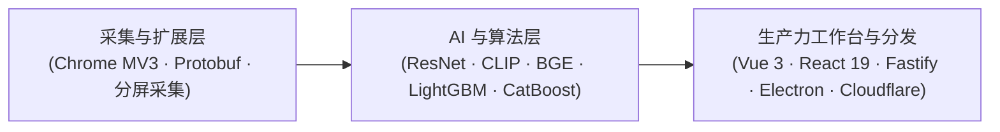

  
  
  

---

### `whoami` · Engineering Philosophy

专注于 **跨境电商 AI 工程落地** 与 **高杠杆效率工具开发** 的全栈开发者 —— 把选品排序、智能组货、高并发生图、POD 印花设计与浏览器/桌面自动化串成真正能交给团队日常使用的生产流水线。

- 🧠 **务实落地的 AI 选品流水线**：融合图像向量（`ResNet18` / `CLIP`）、中文语义（`BGE-small-zh`）与表格特征（`LightGBM` / `CatBoost`），坚持按店铺切分与上架前信号预测，日常专注 Top 5% 高置信决策而非空谈准确率。
- ⚡ **轻量免折腾的产品化思维**：习惯把模型与自动化做成 **零后端本地 HTML**、**Chrome MV3 固定侧边栏扩展**、**Windows CPU 便携包** 与 **Fastify 高并发工作台**，开箱即用、业务同学可直接上手。
- 🕹️ **深耕浏览器与桌面端自动化**：从 Chrome 扩展 Protobuf IM 协议层通信，到 Puppeteer + Electron 桌面机器人与全局防风控限流/实时状态监控，让长周期任务跑得稳、看得见。

---

### 🏛️ Architecture Matrix

---

### 🚀 Featured Projects

<table>
  <tr>
    <td width="50%" valign="top">
      <h4>📊 多模态 AI 选品与智能组货</h4>
      <ul>
        <li>
          <b><a href="https://github.com/Spacexist/temu-product-rank">temu-product-rank</a></b> <code>Pinned</code> 
          图 + 文 + 表多模态 <b>LightGBM</b> 选品排序筛子，按店铺切分验证，每日筛选 Top 5% 上传 Cloudflare（<a href="https://datta-picks.changkaishen7788.workers.dev">Live Demo</a>）
        </li>
        <li>
          <b><a href="https://github.com/Spacexist/Catboost-temu-NewProduction">Catboost-temu-NewProduction</a></b> 
          面向 Home & Kitchen 的上架前周销量选品流水线（<b>CatBoost + BGE-small-zh</b>，5 阶段可复现）
        </li>
        <li>
          <b><a href="https://github.com/Spacexist/temu-resnet-EXE">temu-resnet-EXE</a></b> 
          Windows CPU 便携版选品工具：<b>ResNet18</b> + <b>BGE</b> + <b>LightGBM</b>，面向运营同事的一键出页方案
        </li>
        <li>
          <b><a href="https://github.com/Spacexist/Bundle-temu">Bundle-temu</a></b> 
          基于 <b>CLIP</b> 多模态向量匹配实现 Temu 商品自动化组货
        </li>
      </ul>
    </td>
    <td width="50%" valign="top">
      <h4>🎨 工作台、高并发 AI 生图 &amp; POD</h4>
      <ul>
        <li>
          <b><a href="https://github.com/Spacexist/bundle-product-1688-temu">bundle-product-1688-temu</a></b> <code>Pinned</code> 
          <b>Temu × 1688 智能工作台</b>：采集、组货、AI 生图、SKU 编辑与妙手导出一体（Express + Vue 3 + Vite）
        </li>
        <li>
          <b><a href="https://github.com/Spacexist/High_Tps_Image_Gen">High_Tps_Image_Gen</a></b> 
          面向 OpenAI 兼容生图接口的高并发工作台（<b>React 19 + Fastify 4 + TypeScript</b>）
        </li>
        <li>
          <b><a href="https://github.com/Spacexist/POD-html">POD-html</a></b> <code>Pinned</code> 
          <b>POD Image Workflow</b>：商品采集、印花重绘、Moonshot 元素提取与套图导入本地工作台
        </li>
        <li>
          <b><a href="https://github.com/Spacexist/POD">POD 图片变形编辑器</a></b> 
          纯浏览器免安装单图斜切 / 扇形 / 圆弧透视变形工具，零后端直出 PNG
        </li>
      </ul>
    </td>
  </tr>
  <tr>
    <td width="50%" valign="top">
      <h4>🧩 浏览器扩展与零后端画布</h4>
      <ul>
        <li>
          <b><a href="https://github.com/Spacexist/SPACE-BROWSER">SPACE-BROWSER · 自由画布</a></b> 
          零后端 Chrome MV3 无限协作画布：网页嵌套、Excel/HTML 热插拔、双层点阵与 <code>rAF</code> 合帧渲染
        </li>
        <li>
          <b><a href="https://github.com/Spacexist/Temu-extension">Temu-extension</a></b> <code>Pinned</code> 
          <b>Temu 商品处理统一侧边栏</b>：聚合 1688 核价、GPT 主图自动化、店小秘辅助与分屏采集
        </li>
        <li>
          <b><a href="https://github.com/Spacexist/TIKTOK-sender">TIKTOK-sender</a></b> 
          面向 TikTok Shop Seller IM 的 Chrome MV3 扩展，基于 IM Protobuf API 分页读取与串行发送
        </li>
        <li>
          <b><a href="https://github.com/Spacexist/temu-dianxiaomi-split-extension">temu-dianxiaomi-split-extension</a></b> 
          Chrome 固定侧边栏扩展：支持店小秘半托管按数量批量勾选与分类修正建议采集
        </li>
      </ul>
    </td>
    <td width="50%" valign="top">
      <h4>⚙️ 桌面端自动化 &amp; 技术探索</h4>
      <ul>
        <li>
          <b>GeekRun（基于 <a href="https://github.com/geekgeekrun/geekgeekrun">geekgeekrun</a> 二开）</b> 
          Puppeteer + Electron 桌面端求职自动化工具：改造已读不回固定文案/大模型/图片自由组合、全局摸鱼防风控与实时运行看板
        </li>
        <li>
          <b>System &amp; Anti-Bot Forks</b> 
          持续跟踪研究 <a href="https://github.com/Spacexist/photocraft">photocraft</a>（Rust）、<a href="https://github.com/Spacexist/clash-nyanpasu">clash-nyanpasu</a>（Rust）、<a href="https://github.com/Spacexist/stealth-browser-mcp">stealth-browser-mcp</a> 与 <a href="https://github.com/Spacexist/linux0.11-1">linux0.11-1</a>
        </li>
      </ul>
    </td>
  </tr>
</table>

---

### 🛠️ Tech Stack & Tooling

  

 

  ML &amp; Vision: <code>LightGBM</code> · <code>CatBoost</code> · <code>PyTorch (ResNet / CLIP)</code> · <code>BGE Embeddings</code> 
  Automation &amp; Apps: <code>Chrome Manifest V3</code> · <code>Puppeteer</code> · <code>Electron</code> · <code>Fastify</code> · <code>SQLite</code>

